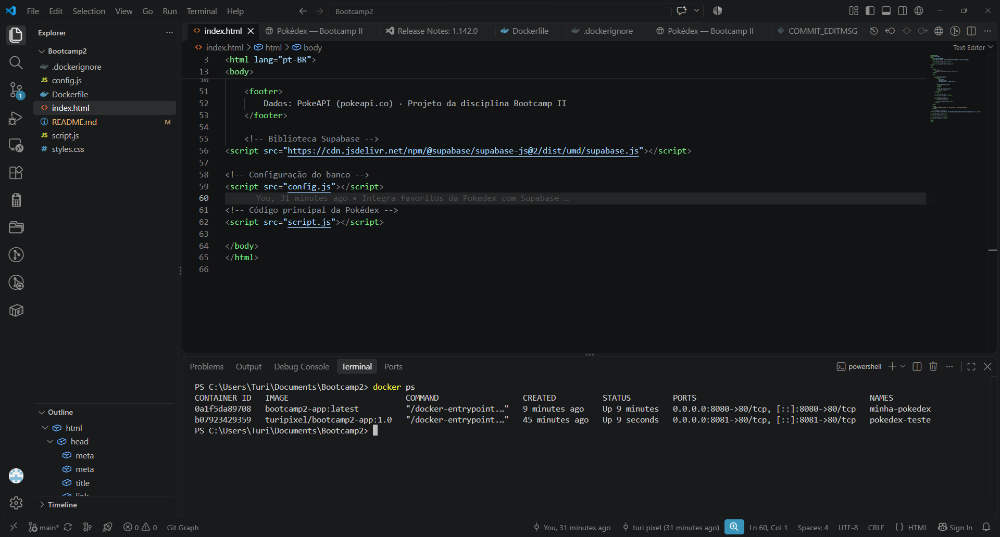

# Pokédex — Bootcamp II | Etapa 02

Aplicação web desenvolvida em **HTML, CSS e JavaScript** que consulta a [PokeAPI](https://pokeapi.co/) e permite salvar Pokémon favoritos em um banco de dados **Supabase (PostgreSQL)**. A aplicação é servida por **Nginx** em um container Docker.

## Links da entrega

- **Repositório GitHub:** https://github.com/turi-pixel/Bootcamp2
- **Aplicação no GitHub Pages:** https://turi-pixel.github.io/Bootcamp2/
- **Imagem no Docker Hub:** https://hub.docker.com/r/turipixel/bootcamp2-app

## Funcionalidades

- Buscar Pokémon por nome ou número e sortear um Pokémon aleatório.
- Exibir imagem, número, altura, peso e tipos traduzidos para português.
- Calcular fraquezas, resistências e imunidades com dados da PokeAPI.
- Adicionar, listar e remover Pokémon favoritos com persistência no Supabase.
- Manter os favoritos após atualizar ou reabrir a página.

## Executar com Docker

É necessário ter o Docker instalado e uma conexão com a internet para consultar a PokeAPI e o Supabase.

```bash
docker run -d --name pokedex-bootcamp2 -p 8080:80 turipixel/bootcamp2-app:latest
```

Acesse **http://localhost:8080**.

Para interromper e remover o container:

```bash
docker stop pokedex-bootcamp2
docker rm pokedex-bootcamp2
```

Para construir localmente a partir do repositório:

```bash
docker build -t bootcamp2-app:latest .
docker run -d --name pokedex-local -p 8080:80 bootcamp2-app:latest
```

## Persistência de dados — Supabase

- **Banco escolhido:** Supabase, baseado em PostgreSQL.
- **Tabela:** `public.favoritos`.
- **Estrutura utilizada:**

| Coluna | Tipo | Finalidade |
| --- | --- | --- |
| `id` | `bigint` | Identificador interno do registro (chave primária). |
| `pokemon_id` | `integer` | Número do Pokémon na Pokédex (único). |
| `nome` | `text` | Nome do Pokémon. |
| `imagem` | `text` | URL da imagem do Pokémon. |
| `criado_em` | `timestamptz` | Data/hora de criação do registro. |

**Dados salvos:** número, nome e URL da imagem de cada Pokémon favoritado, além do identificador e data de criação do registro. Os dados de altura, peso e relações de tipos são consultados na PokeAPI e não são persistidos nessa tabela.

**Operações:** adicionar (`upsert`), listar (`select`) e excluir (`delete`). A lista é carregada novamente ao abrir a aplicação, demonstrando persistência fora do navegador.

**Limitação conhecida:** o projeto acadêmico utiliza chave pública de API e políticas RLS de demonstração que podem permitir acesso anônimo compartilhado aos favoritos. Não há contas individuais nem isolamento por usuário; não devem ser armazenados dados pessoais ou privados nessa tabela. Nunca incluir chave `service_role` ou chave secreta no frontend.

## Sidequests obrigatórias — evidências

### SQ1 — `.dockerignore`

Arquivo [`.dockerignore`](.dockerignore) na raiz do projeto. Exclui arquivos desnecessários do contexto de build, como metadados Git e arquivos de documentação, reduzindo a quantidade de dados enviados ao Docker e podendo acelerar a construção da imagem.

### SQ2 — Versionamento das imagens

Repositório: https://hub.docker.com/r/turipixel/bootcamp2-app/tags

Tags utilizadas: `1.0` (versão inicial), `1.1` (versão com melhorias) e `latest` (versão atual).

### SQ3 — Descrição no Docker Hub

O [Docker Hub](https://hub.docker.com/r/turipixel/bootcamp2-app) apresenta a página da imagem Docker. A descrição (*Overview*) pode incluir informações do projeto, link do GitHub e o comando `docker run` desta documentação.

### SQ4 — Dois containers e Kubernetes

Dois containers da Pokédex podem ser executados simultaneamente em portas diferentes:

```bash
docker run -d --name minha-pokedex -p 8080:80 turipixel/bootcamp2-app:latest
docker run -d --name pokedex-teste -p 8081:80 turipixel/bootcamp2-app:1.0
docker ps
```

#### Evidência — execução simultânea de containers

Foram executados dois containers Docker simultaneamente:

- `minha-pokedex`: porta 8080, imagem atualizada.
- `pokedex-teste`: porta 8081, imagem versão 1.0.

A execução foi comprovada utilizando o comando `docker ps`.



**Como gerenciar 100 containers?** Em vez de iniciar, monitorar e reiniciar cada container manualmente, utilizaria o **Kubernetes**, uma plataforma de orquestração. Um **cluster** reúne máquinas capazes de executar aplicações; um **Pod** é a unidade básica de execução, contendo um ou mais containers; e **réplicas**, normalmente gerenciadas por um *Deployment*, mantêm várias instâncias da aplicação disponíveis. O Kubernetes ajuda a distribuir cargas, substituir instâncias com falhas e ampliar ou reduzir a quantidade de réplicas.

## Histórico e entrega

A Etapa 02 continua no mesmo repositório da Etapa 01. O histórico de commits deve evidenciar a evolução do projeto; o histórico de commits registra as alterações realizadas.

**Entrega no Moodle:** arquivo `README.md`. As evidências permanecem no repositório GitHub.
